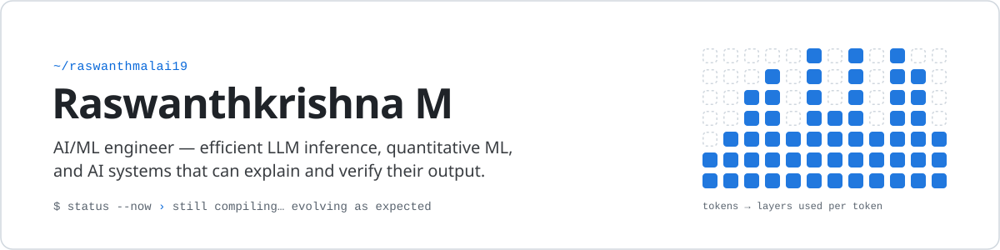

<picture>
  <source media="(prefers-color-scheme: dark)" srcset="assets/header-dark.svg">
  
</picture>

  <a href="https://www.linkedin.com/in/raswanthkrishna-m-607a032b6/">LinkedIn</a> ·
  <a href="https://x.com/RASWANTH_MALAI">X</a> ·
  <a href="https://orcid.org/0009-0003-8303-4854">ORCID</a> ·
  <a href="https://www.credly.com/users/raswanthkrishna-m">Credly</a> ·
  <a href="https://pypi.org/project/tensorquantlib/">PyPI</a>

I'm an AI/ML undergraduate who likes turning ideas into working systems. Most of what I build sits where machine learning meets real constraints: making language models run well on the hardware people actually own, pricing risk with numerical methods I can inspect line by line, and shipping ML tools that explain their decisions and state their limits.

I try to keep my READMEs honest — each project says what the code can and cannot back up, and benchmark numbers come with the setup they were measured on.

**Recent focus**

- Adaptive runtimes for on-device LLM inference — layer skipping, model cascades and KV-cache budgets on Apple Silicon ([ARIA](https://github.com/raswanthmalai19/ARIA-ADAPTIVE-RUNTIME-INTELLIGENCE-ARCHITECTURE))
- Local-first, hardware-aware routing across specialist open models ([multi-LLM orchestration](https://github.com/raswanthmalai19/hardware-aware-multi-llm-orchestration))
- Maintaining [TensorQuantLib](https://github.com/raswanthmalai19/TensorQuantLib), a quantitative-finance library published on PyPI

## Selected work

| Project | What it is | Built with |
|:--|:--|:--|
| **[TensorQuantLib](https://github.com/raswanthmalai19/TensorQuantLib)** | Quant-finance library with tensor-train compression of pricing surfaces and a from-scratch reverse-mode autodiff engine for first- and second-order Greeks. Black-Scholes, Heston, American (LSM), exotic and Monte Carlo engines. On PyPI, with CI, strict typing and a docs site. | NumPy · SciPy · mypy · GitHub Pages |
| **[ARIA](https://github.com/raswanthmalai19/ARIA-ADAPTIVE-RUNTIME-INTELLIGENCE-ARCHITECTURE)** | Runtime layer that adapts transformer inference to query complexity: dynamic layer execution, a 0.5B → 3B model cascade, speculative decoding and complexity-scaled KV-cache. The README reports ~1.7× mixed-workload speed-up and ~52% lower memory on Qwen 2.5 3B. | Python · MLX · FastAPI · Electron |
| **[Multi-LLM Orchestration](https://github.com/raswanthmalai19/hardware-aware-multi-llm-orchestration)** | Local assistant that routes each request to a specialist model by task, difficulty and hardware profile, validates generated code in a sandboxed subprocess and keeps preference memory. No hosted inference API. | Ollama · ChromaDB · sentence-transformers |
| **[ReconQ](https://github.com/raswanthmalai19/Reconq-Razorpay)** | Payment reconciliation where the confidence needed to auto-clear a transaction scales with its rupee value. On the bundled 154-record sample, the banded policy wrongly cleared ₹0 against ₹15.6 lakh for a flat 85% threshold using the same model. | FastAPI · React · scikit-learn · Gemini |
| **[EVALIX](https://github.com/raswanthmalai19/EVALIX)** | Explainable credit-risk scoring with calibration, SHAP explanations, DiCE counterfactuals and fairness diagnostics behind a FastAPI service. Research and demonstration only. | XGBoost · SHAP · DiCE · FastAPI |
| **[Ghost Data Audit](https://github.com/raswanthmalai19/Ghost-Data-Audit)** | Deterministic pipeline that checks whether data was really deleted after a request — across replicas, exports, logs, search indexes and backups — and writes an evidence-backed remediation plan. | Python · Tesseract OCR |

<b>More projects</b> — vision, research reproductions, optimisation and hardware

 

| Project | What it is |
|:--|:--|
| [VisionQA](https://github.com/raswanthmalai19/VisionQA) | Agent that crawls a site, reads the UI with Gemini vision and runs end-to-end tests from a plain-English objective. Built for the Gemini Live Agent Challenge. |
| [MACHER](https://github.com/raswanthmalai19/Macher-v1) | Real-time phone-scam detection from call transcripts, Android client with an AWS backend (API Gateway WebSocket, Lambda, Bedrock, DynamoDB). Built for the AWS 10,000 AIdeas competition. |
| [VORq](https://github.com/raswanthmalai19/VORq--Vectorized-Ontology-for-Risk-Quantification) | Scenario-driven risk engine: Bayesian scenario branches, causal propagation across sectors, Student-t Monte Carlo with GARCH volatility, VaR/CVaR. |
| [μSAM on LIVECell](https://github.com/raswanthmalai19/MIP-LIVECELL) | Reproduction study of Segment Anything for Microscopy on LIVECell, plus an investigation of weak automatic segmentation with an attention-bias fix and a high-resolution decoder. |
| [TamilScript AI](https://github.com/raswanthmalai19/tamilscrpit-nlp) | Research-first OCR pipeline for ancient Tamil inscriptions (Tamil-Brahmi, Vatteluttu, Grantha), with script routing, normalisation and translation. |
| [InterviewSense](https://github.com/raswanthmalai19/interviewsense-communication-model) | Speech analysis for mock interviews: Faster-Whisper transcription, delivery and fluency metrics, and a trained fluency model. |
| [OhioCharge](https://github.com/raswanthmalai19/EV-Charging-Station-Network-Optimization) | EV charger placement as a maximal covering location problem (integer programming with PuLP/CBC) plus a knapsack sub-problem, with a FastAPI + React dashboard. |
| [GreenCluster](https://github.com/raswanthmalai19/GreenCluster-Carbon-Optimized-Workload-Forecasting) | Carbon-aware batch scheduling built on the Alibaba 2018 cluster trace (~95M rows) with Spark, time-series forecasting and conformal intervals. |
| [News Summarizer](https://github.com/raswanthmalai19/news-summarizer-bart-lora) | Extractive TF-IDF and abstractive BART summarisation with a LoRA (PEFT) fine-tuning script. |
| [PredictCart](https://github.com/raswanthmalai19/PredictCart) | Price regression for Amazon India listings that combines BERT text embeddings with tabular features in a compact transformer. |
| [VisionCraft](https://github.com/raswanthmalai19/VisionCraft-Text-to-Comic-Video-Generator) | Text to comic strips and short animated videos with Stable Diffusion and semantic scene chunking. |
| [Pest-detection robot](https://github.com/raswanthmalai19/robotics-pest-detection) | Raspberry Pi 5 two-wheel robot running real-time pest classification with EfficientNetV2-B0. |
| [FingerForge](https://github.com/raswanthmalai19/fingerforge-Hand-sculpted-3D-construction) | Building 3D voxel structures in AR with MediaPipe hand gestures. |
| [Virus signature detection](https://github.com/raswanthmalai19/fla-virus-detection) | Malware-signature scanning with KMP, Aho-Corasick and DFA string matchers behind a Flask API. |

## Hackathons and competitions

- **Gemini Live Agent Challenge** — [VisionQA](https://github.com/raswanthmalai19/VisionQA), UI Navigator category
- **Razorpay AI Buildathon 2026** — [ReconQ](https://github.com/raswanthmalai19/Reconq-Razorpay)
- **AWS 10,000 AIdeas** — [MACHER](https://github.com/raswanthmalai19/Macher-v1) · [write-up](https://builder.aws.com/content/3AtSKEZm9cp3o0AbWm71bVjJHXh/macher-a-real-time-ai-bodyguard-against-phone-scams) · [demo](https://www.youtube.com/watch?v=3nF1vkQZ5SY)
- **Auraflix Hackathon** — [MOODSYNC](https://github.com/raswanthmalai19/MOODSYNC), mood-based content recommendations

## Toolbox

| | |
|:--|:--|
| **Languages** | Python · TypeScript · JavaScript · Java · C++ |
| **Machine learning** | PyTorch · TensorFlow / Keras · Hugging Face Transformers · PEFT / LoRA · scikit-learn · XGBoost · SHAP |
| **LLMs and agents** | MLX · Ollama · LangChain · Gemini API · Amazon Bedrock · ChromaDB |
| **Vision** | OpenCV · MediaPipe · Diffusers / Stable Diffusion |
| **Data and numerics** | NumPy · SciPy · pandas · Apache Spark · statsmodels |
| **Apps and services** | FastAPI · Flask · React · Next.js · Node.js · Flutter · Streamlit |
| **Infrastructure** | Docker · AWS · Google Cloud · GitHub Actions · Vercel · MongoDB · MySQL · Redis |

## Activity

<picture>
  <source media="(prefers-color-scheme: dark)" srcset="https://raw.githubusercontent.com/raswanthmalai19/raswanthmalai19/output/github-contribution-grid-snake-dark.svg">
  
</picture>

 

<i>Still compiling… evolving as expected.</i>

